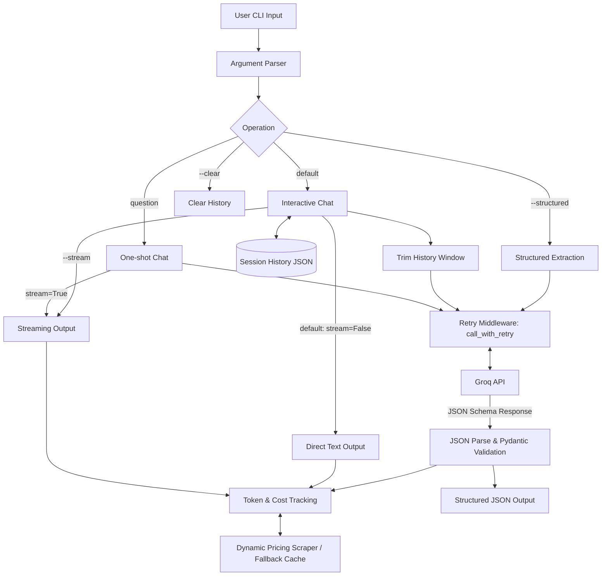

# CLI AI Assistant

A resilient, feature-packed Command Line AI Assistant powered by Groq and Pydantic.

## Architecture

## Features

- **One-shot Questions**: Ask quick questions directly from the command line with streaming output.
- **Interactive Chat**: Multi-turn chat with persistent session history and configurable rolling context windows.
- **Session Management**: Maintain isolated conversation histories using `--session <name>`.
- **Structured Data Extraction**: Extract validated JSON with strict Pydantic schemas.
- **Model Switching & Temperature Control**: Customize model (`--model`) and sampling randomness (`--temperature`).
- **Resilient API Calls**: Automatic exponential backoff retry mechanism on rate limits, connection errors, and 5xx server issues.
- **Token & Cost Tracking**: Live cost estimation with dynamic pricing scraping and reliable local fallbacks.
